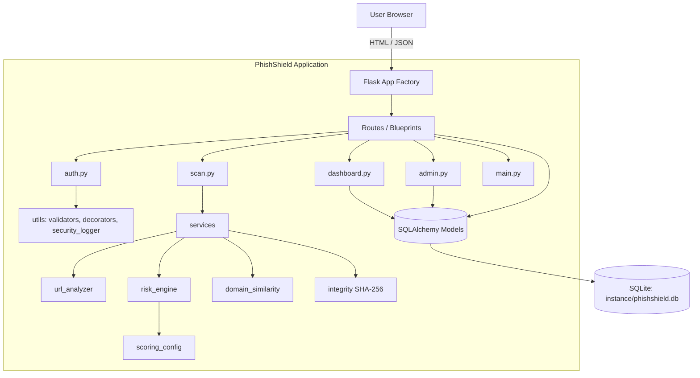
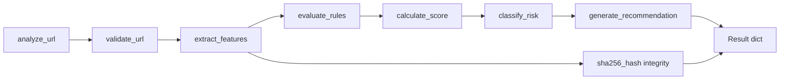
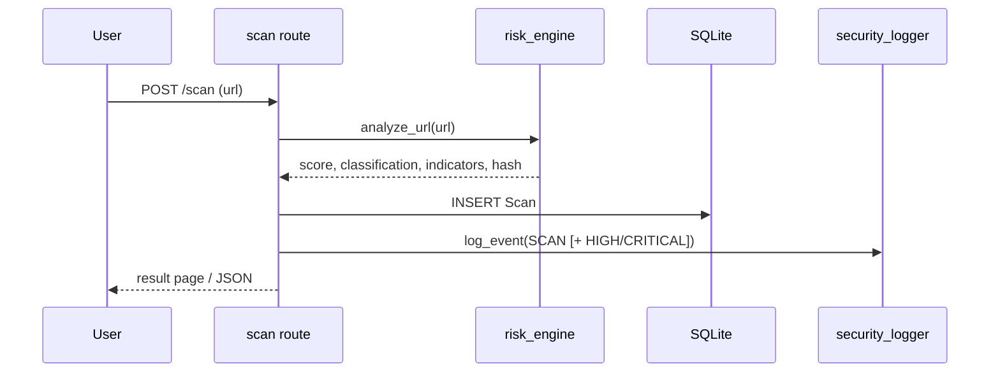
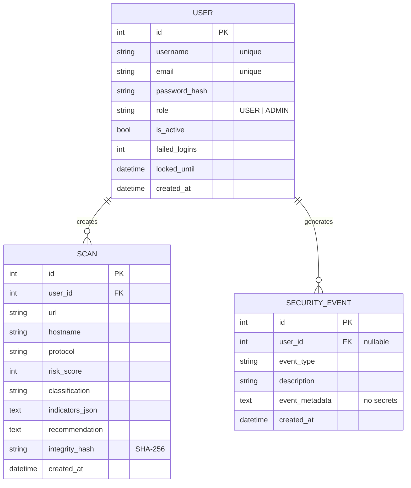

# PhishShield - Architecture

## High-level component diagram

## Risk-engine data flow

The engine is Flask-independent, so each stage is unit-testable in isolation.

## Scan request sequence

## Module relationships

- **routes/** depend on **services/**, **models/**, and **utils/**.
- **services/risk_engine** composes **url_analyzer**, **domain_similarity**,
  **integrity**, and reads weights from **scoring_config**.
- **utils/decorators** enforce RBAC and log unauthorized attempts via
  **utils/security_logger**.
- All persistence goes through **models/** (SQLAlchemy) — no raw SQL anywhere.

## Database relationships (ER)

## Request handling layers

1. **HTTP layer** — Flask blueprints, CSRF on forms, security headers, error handlers.
2. **Authorization layer** — `login_required` / `login_required_api` / `admin_required`.
3. **Domain layer** — services (analysis, scoring, similarity, hashing).
4. **Persistence layer** — SQLAlchemy models over SQLite.
